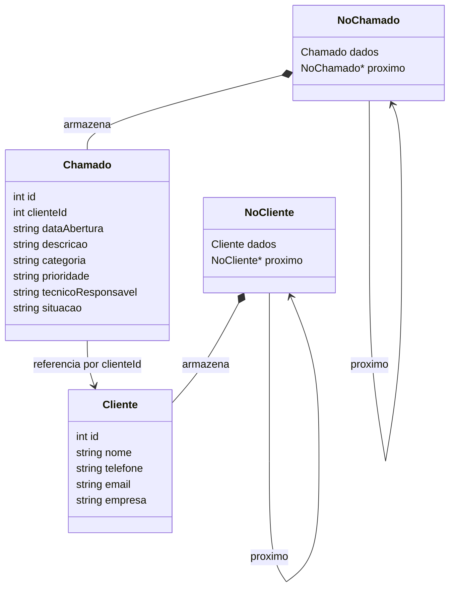

# Diagrama de Classes — Projeto Final de Estrutura de Dados

## 1. Modelo de Domínio

O sistema utiliza estruturas de dados baseadas em listas simplesmente encadeadas para armazenar e gerenciar clientes e chamados de suporte técnico.

O modelo é composto por quatro estruturas principais: `Cliente`, `Chamado`, `NoCliente` e `NoChamado`.

## 2. Descrição das Estruturas

### 2.1 Cliente

Representa um cliente cadastrado no sistema, armazenando suas informações de identificação e contato.

| Atributo | Tipo | Descrição |
|---|---|---|
| `id` | int | Identificador único gerado automaticamente |
| `nome` | string | Nome do cliente |
| `telefone` | string | Telefone de contato |
| `email` | string | Endereço de e-mail |
| `empresa` | string | Empresa ou organização do cliente |

### 2.2 Chamado

Representa uma solicitação de suporte técnico vinculada a um cliente cadastrado.

| Atributo | Tipo | Descrição |
|---|---|---|
| `id` | int | Identificador único do chamado |
| `clienteId` | int | Identificador do cliente relacionado |
| `dataAbertura` | string | Data de abertura do chamado |
| `descricao` | string | Descrição do problema |
| `categoria` | string | Categoria do chamado |
| `prioridade` | string | Nível de prioridade |
| `tecnicoResponsavel` | string | Técnico responsável pelo atendimento |
| `situacao` | string | Estado atual do chamado |

**Valores iniciais:**
- `tecnicoResponsavel`: "Nao atribuido".
- `situacao`: "Pendente".

### 2.3 NoCliente

Estrutura responsável por representar um nó da lista simplesmente encadeada de clientes.

| Atributo | Tipo | Descrição |
|---|---|---|
| `dados` | Cliente | Armazena os dados do cliente |
| `proximo` | NoCliente* | Ponteiro para o próximo nó |

É utilizada para organizar dinamicamente os clientes cadastrados, permitindo inserções, consultas e liberação de memória.

### 2.4 NoChamado

Estrutura responsável por representar um nó da lista simplesmente encadeada de chamados.

| Atributo | Tipo | Descrição |
|---|---|---|
| `dados` | Chamado | Armazena os dados do chamado |
| `proximo` | NoChamado* | Ponteiro para o próximo nó |

Permite o armazenamento dinâmico dos chamados, mantendo a ligação entre os elementos da lista.

## 3. Relacionamentos

O modelo apresenta os seguintes relacionamentos:

- **NoCliente e Cliente:** cada nó armazena os dados de um cliente.
- **NoChamado e Chamado:** cada nó armazena os dados de um chamado.
- **Chamado e Cliente:** um chamado referencia seu cliente por meio do atributo `clienteId`.
- **Nós da mesma estrutura:** o ponteiro `proximo` estabelece a ligação entre os elementos de cada lista encadeada.

A associação entre chamados e clientes é realizada por identificadores, sem a necessidade de armazenar diretamente um ponteiro para o objeto `Cliente`.

## 4. Funcionamento no Código

### 4.1 Geração de identificadores

Os identificadores são gerados automaticamente por funções específicas:

- `gerarIdCliente()`: utiliza um contador estático iniciado em 1, incrementado a cada novo cadastro.
- `gerarIdChamado()`: utiliza um contador estático iniciado em 1, incrementado a cada novo chamado.

Isso permite identificar individualmente os registros durante a execução do programa.

### 4.2 Validação de clientes

Durante a abertura de um chamado, a função `abrirChamado()` utiliza `clienteExiste()` para verificar se o identificador informado corresponde a um cliente cadastrado.

Caso o cliente não seja encontrado, o chamado não é inserido na lista e uma mensagem de erro é apresentada.

### 4.3 Gerenciamento de memória

Como as listas utilizam alocação dinâmica de memória, é necessário liberar os nós antes do encerramento do programa.

- `liberarClientes()`: percorre a lista de clientes, desalocando todos os nós.
- Liberação dos chamados em `main()`: percorre a lista de chamados e desaloca seus respectivos nós.

Esse procedimento evita vazamentos de memória durante a execução do programa.

## 5. Organização dos Arquivos

A implementação das estruturas está distribuída da seguinte maneira:

| Arquivo | Responsabilidade |
|---|---|
| `include/cliente.hpp` | Declaração das estruturas e funções relacionadas aos clientes |
| `include/chamado.hpp` | Declaração das estruturas e funções relacionadas aos chamados |
| `src/clientes.cpp` | Implementação das operações de clientes |
| `src/chamados.cpp` | Implementação das operações de chamados |
| `src/main.cpp` | Interface de interação e execução do sistema |
| `docs/diagrama_classes.md` | Documentação do modelo de domínio e das estruturas |

## 6. Considerações Finais

A organização do sistema utiliza listas simplesmente encadeadas para implementar o armazenamento dinâmico de clientes e chamados.

A separação entre os dados (`Cliente` e `Chamado`) e os nós responsáveis pelo encadeamento (`NoCliente` e `NoChamado`) permite uma implementação modular, facilitando a manutenção e a compreensão das estruturas de dados utilizadas no projeto.